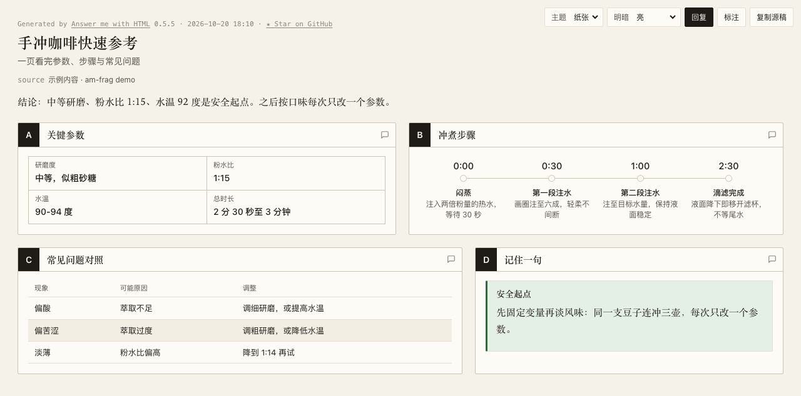

# am-frag

**Turn [answer-me-with-html](https://github.com/QingYunA/answer-me-with-html) pages into ZCode (Gen UI) inline fragments.**

把 `am render` 生成的完整单页 HTML 转成 ZCode 对话内联渲染（Gen UI）可用的 HTML 片段。



<sub>示例页由 am 渲染（paper 主题）；am-frag 将其转换为片段后内联渲染于 ZCode 对话中。</sub>

## 解决什么问题

- [ZCode](https://zcode.z.ai) 桌面端的 Gen UI 只接受 **HTML 片段**（无 `<!doctype>`/`<html>`/`<head>`/`<body>` 的文档壳），塞整页进去会报 `Gen UI requires an HTML fragment`；
- [answer-me-with-html](https://github.com/QingYunA/answer-me-with-html)（`am`）为了离线可分享，**只输出完整单文件页面**；
- 两者单看都对，合用就断——am-frag 把这座桥接上：**am 管内容和视觉设计，am-frag 管形态适配**。

## 用法

```bash
# 1. 用 am 渲染整页（见上游文档）
node /path/to/skills/answer-me-with-html/scripts/am.mjs render - --no-open \
  -o /tmp/page.html <<'EOF'
---
title: 示例
---
## A 面板
```timeline
10-01 | 事件一 | 说明
10-02 | 事件二 | 说明
```
EOF

# 2. 转成片段（默认 paper 主题、明暗跟随系统）
python3 am-frag.py /tmp/page.html /path/to/session-visualizations/demo.html
```

选项：`--theme paper|blueprint|shadcn`（默认 `paper`）、`--mode light|dark|auto`（默认 `auto`）。

## 转换做了什么

1. 剥掉文档壳，`<html>` 上的根属性（`data-theme`/`data-mode`/`data-style`/`lang`）搬到根节点 `div#amfrag`；
2. CSS 中全部 `html`/`body` 选择器重写到 `#amfrag`（主题变量、字体、排版随之在片段内生效）；
3. JS 中 `document.documentElement` / `document.body` 重定向到 `#amfrag`（ZCode 沙箱 iframe 内隔离运行，不污染宿主）；
4. `position: fixed` 的工具栏/回复条/灯箱改为锚定片段根并预留顶部空间，避免遮挡内容；
5. 校验输出不含文档级标签，转换不完整直接报错退出。

## 已验证版本

- answer-me-with-html `0.5.5` + ZCode `3.16.2`（macOS arm64，2026-10-20）。
- am 升级若改内部 CSS 结构（类名/选择器形态），转换规则需同步跟进——脚本自带结构校验，失配会报错而不是产出坏片段。

## 这不是 fork

am-frag 不包含、也不修改 answer-me-with-html 的任何代码；它是独立的输出后处理器。感谢上游 [QingYunA/answer-me-with-html](https://github.com/QingYunA/answer-me-with-html)（MIT）设计的草稿→CLI 渲染架构——内容与视觉分离，本工具才只需做形态转换。

## License

MIT
